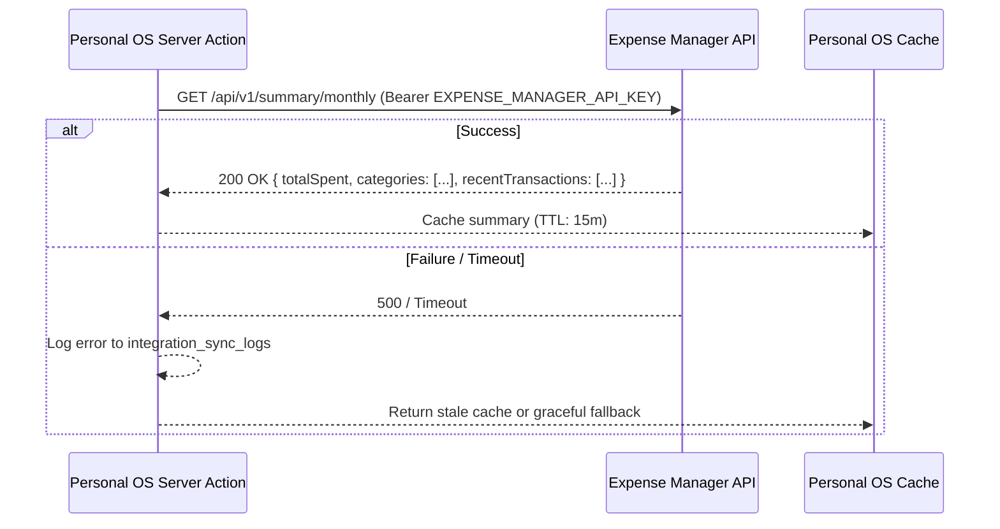

# API & Integration Contracts --- Personal OS

**Version:** 1.0  

---

## 1. Authentication Server Actions

Personal OS uses Next.js Server Actions for authentication mutations, enforcing Zod validation and HTTP-only cookie persistence.

### `loginAction(values: LoginInput): Promise<AuthActionResult>`
- **Input:** `{ email: string, password: string }`
- **Output:** `{ success?: boolean, error?: string, fieldErrors?: Record<string, string[]> }`
- **Redirects:** `/dashboard` on success.

### `registerAction(values: RegisterInput): Promise<AuthActionResult>`
- **Input:** `{ fullName: string, email: string, password: string }`
- **Output:** `{ success?: boolean, error?: string, fieldErrors?: Record<string, string[]> }`
- **Behavior:** Provisions account in Supabase Auth, triggers profile and preference creation. Returns `{ success: true }` when email confirmation is required.

### `forgotPasswordAction(values: ForgotPasswordInput): Promise<AuthActionResult>`
- **Input:** `{ email: string }`
- **Output:** `{ success: boolean, error?: string }`
- **Behavior:** Sends password reset link directing user to `/api/auth/callback?next=/reset-password`.

### `updatePasswordAction(values: ResetPasswordInput): Promise<AuthActionResult>`
- **Input:** `{ password: string, confirmPassword: string }`
- **Output:** `{ error?: string }`
- **Redirects:** `/dashboard` upon successful update.

### `signOutAction(): Promise<void>`
- **Behavior:** Clears session and cookies, redirects to `/login`.

---

## 2. Route Handlers

### `GET /api/auth/callback`
- **Purpose:** Exchanges PKCE authorization code for session tokens during email verification and password reset flows.
- **Parameters:**
  - `code` (string, required): Supabase auth exchange token.
  - `next` (string, optional): Target redirect URL (validated as a relative path).

### `POST /api/auth/signout`
- **Purpose:** Form action endpoint for logging out programmatically.

---

## 3. Expense Manager Integration Contract (Phase 4 Specification)

The existing Expense Manager remains an independent system and retains ownership of all financial transactions.

### Integration Rules:
1. **Read-Only Default:** Personal OS never performs write or delete operations on the financial database.
2. **Server-Side Only:** `EXPENSE_MANAGER_API_KEY` and `EXPENSE_MANAGER_API_URL` are strictly server-side environment variables.
3. **No Direct Database Querying:** Personal OS will not connect directly to the Expense Manager's PostgreSQL instance. All data passes through the authenticated REST API.
