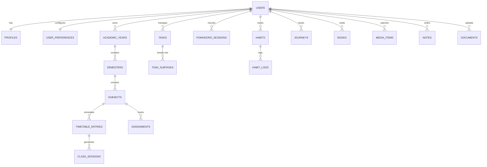

# Database Architecture & Schema --- Personal OS

**Backend:** Supabase PostgreSQL  
**Version:** 1.0  

---

## 1. Database Conventions

- **Primary Keys:** UUID v4 (`gen_random_uuid()` or mapped to `auth.users(id)`).
- **Ownership:** Every user-owned table includes `user_id UUID REFERENCES auth.users(id) ON DELETE CASCADE`.
- **Timestamps:** UTC `TIMESTAMPTZ` (`created_at`, `updated_at`).
- **Triggers:** Automated `handle_updated_at` trigger updates timestamp on record modification.
- **Row Level Security (RLS):** Enabled on 100% of tables with strict `(SELECT auth.uid())` policies.

---

## 2. Phase 0 Executed Migrations

### Migration: `20261106000100_create_profiles.sql`
Creates the `profiles` table linked 1:1 with `auth.users`.

```sql
CREATE TABLE public.profiles (
  id UUID PRIMARY KEY REFERENCES auth.users(id) ON DELETE CASCADE,
  email TEXT NOT NULL,
  full_name TEXT,
  avatar_url TEXT,
  created_at TIMESTAMPTZ NOT NULL DEFAULT timezone('utc'::text, now()),
  updated_at TIMESTAMPTZ NOT NULL DEFAULT timezone('utc'::text, now())
);
```

- **Trigger:** `on_auth_user_created` fires after signup in `auth.users` to automatically populate the profile.

### Migration: `20261106000200_create_user_preferences.sql`
Creates user configuration defaults for themes, timezones, and Pomodoro settings.

```sql
CREATE TABLE public.user_preferences (
  id UUID PRIMARY KEY DEFAULT gen_random_uuid(),
  user_id UUID NOT NULL REFERENCES auth.users(id) ON DELETE CASCADE UNIQUE,
  theme TEXT NOT NULL DEFAULT 'system' CHECK (theme IN ('light', 'dark', 'system')),
  timezone TEXT NOT NULL DEFAULT 'UTC',
  date_format TEXT NOT NULL DEFAULT 'yyyy-MM-dd',
  time_format TEXT NOT NULL DEFAULT '24h' CHECK (time_format IN ('12h', '24h')),
  pomodoro_work_duration INT NOT NULL DEFAULT 25 CHECK (pomodoro_work_duration > 0),
  pomodoro_short_break INT NOT NULL DEFAULT 5 CHECK (pomodoro_short_break > 0),
  pomodoro_long_break INT NOT NULL DEFAULT 15 CHECK (pomodoro_long_break > 0),
  pomodoro_long_break_interval INT NOT NULL DEFAULT 4 CHECK (pomodoro_long_break_interval > 0),
  created_at TIMESTAMPTZ NOT NULL DEFAULT timezone('utc'::text, now()),
  updated_at TIMESTAMPTZ NOT NULL DEFAULT timezone('utc'::text, now())
);
```

### Migration: `20261106000300_create_storage_buckets.sql`
Provisions private storage buckets with user folder ownership isolation:
- `user_documents`: 10MB limit, restricted to PDF, PNG, JPG, WebP, Plain Text.
- `avatars`: 2MB limit, restricted to PNG, JPG, WebP.
- Policy check: `(storage.foldername(name))[1] = (SELECT auth.uid()::text)`.

---

## 3. Entity Relationship Overview (Planned Phases 1-4)



---

## 4. Security & Isolation Guarantee

Every query executed by `@supabase/ssr` passes the user's JWT. PostgreSQL executes:
```sql
USING (user_id = (SELECT auth.uid()))
WITH CHECK (user_id = (SELECT auth.uid()))
```
Cross-tenant reads, blind ID spoofing, or data overwriting from other accounts are rejected at the database engine level.
