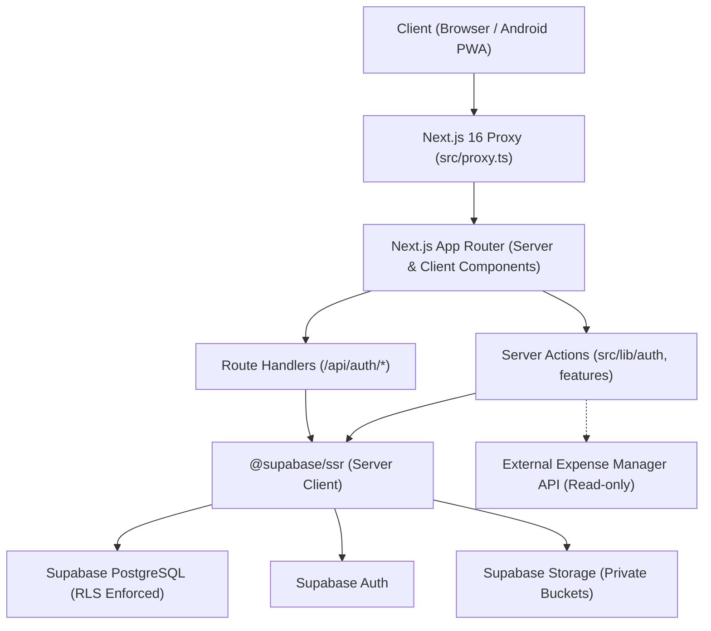

# Technical Specification --- Personal OS

**Version:** 1.0  
**Stack:** Next.js 16 (App Router) &bull; React 19 &bull; TypeScript &bull; Tailwind CSS v4 &bull; Supabase  

---

## 1. System Architecture

Personal OS is structured as a **modular monolith** running on Next.js 16 and Supabase.



---

## 2. Directory & Modular Conventions

```text
src/
├── app/
│   ├── (auth)/             # Authentication route group (Login, Register, Password Reset)
│   ├── (app)/              # Authenticated workspace route group (Dashboard, Academics, ...)
│   ├── api/                # API Route handlers (Auth callbacks, webhooks)
│   ├── layout.tsx          # Root HTML shell, fonts, ThemeProvider, PwaRegister
│   └── globals.css         # Tailwind v4 theme definitions and design tokens
├── components/
│   ├── ui/                 # Reusable primitive UI components (Button, Input, Card, Sheet, etc.)
│   ├── layout/             # Top-level shell layouts (AppShell)
│   ├── navigation/         # DesktopSidebar, MobileNav, NavItems definitions
│   └── shared/             # EmptyState, LoadingSkeleton
├── features/               # Domain-specific business logic and utilities
│   ├── academics/
│   ├── attendance/         # Attendance percentage derivation engine
│   ├── pomodoro/           # Timestamp-based elapsed timer utilities
│   └── ...
├── lib/
│   ├── supabase/           # client.ts, server.ts, admin.ts, proxy.ts
│   ├── auth/               # actions.ts (Server Actions)
│   └── validation/         # Zod schemas
└── types/                  # Database and domain TypeScript definitions
```

---

## 3. Server vs. Client Component Conventions

- **Server Components (Default):**
  - Used for layout shells, initial data fetching, and security authorization checks.
  - Keeps bundle sizes minimal and eliminates client-side waterfall requests.
- **Client Components (`'use client'`):**
  - Reserved strictly for user interactivity: forms (`react-hook-form`), interactive dropdowns, mobile navigation drawer states, and browser-driven timers.
- **Next.js 16 Request Handling:**
  - `cookies()` is accessed asynchronously: `const cookieStore = await cookies()`.
  - Dynamic route groups opting out of static instant shell use `export const instant = false`.

---

## 4. Next.js 16 Proxy Architecture

The root file `src/proxy.ts` replaces legacy middleware:
1. **Session Sync:** Invokes `updateSession` to refresh expired Supabase tokens seamlessly.
2. **Route Guarding:**
   - Unauthenticated requests to protected paths (`/dashboard`, `/academics`, `/productivity`, etc.) are redirected to `/login?redirectTo=...`.
   - Authenticated sessions accessing `/`, `/login`, or `/register` are redirected to `/dashboard`.
3. **Open-Redirect Protection:** Redirect destinations must be relative paths.

---

## 5. PWA & Offline Strategy

- **Manifest:** Generated dynamically by `src/app/manifest.ts` providing `standalone` display mode, high-res maskable icons, and dark theme colors.
- **Service Worker (`public/sw.js`):**
  - Precaches `/offline.html` and PWA icon assets on install.
  - Intercepts navigation requests; serves `/offline.html` if network connectivity is severed.
- **Cloud-First Contract:** The v1 release requires network access for mutations. Offline modifications are gracefully blocked by the offline fallback page to protect data consistency.
